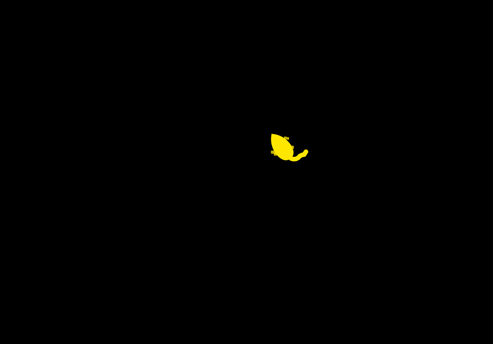
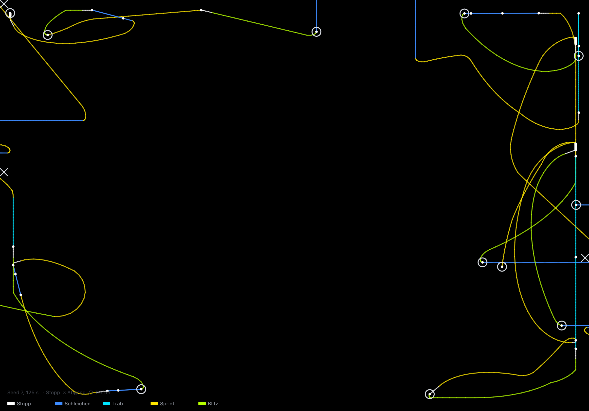

# Müsli

A screen hunting game for cats. Bright prey runs, freezes, peeks and vanishes on a black screen; a paw on it is a
catch. Runs in the browser on iPad, iPhone and desktop.

**Play it: <https://games.trick77.com/muesli/>**



## Playing

- Tap **Tippen zum Starten**. That tap also turns on sound, keeps the screen awake and goes fullscreen where the
  browser allows it.
- A session lasts 2 minutes (3 or 5 in the settings) and ends on its own with an easy last catch. Give a treat then.
  A new round takes a 1 second hold on the restart mark, so the cat cannot start one.
- Pause: hold the spots near the top-left and bottom-right corners together for 1.5 seconds (Escape on a desktop).
- iPad and iPhone: *Share → Add to Home Screen* for real fullscreen. *Guided Access* (Settings → Accessibility)
  stops a paw from leaving the app.

## How it tries to stay interesting

- Prey-like motion, not a screensaver: stop-and-go bursts along the walls, freezes before a dash, five speed bands
  from still to a rare all-out dash, flight away from the paw to the nearest cover.
- It leaves the screen every 10 to 30 seconds and stays away for a random 0.5 to 10 seconds.
- It comes back changed (shape, colour or size): a cat's play fades on an unchanging toy and returns for a changed
  one (Hall, Bradshaw & Robinson 2002).
- Only blue, cyan, yellow and lime: cats are dichromats, red reads as dark grey to them.
- Hits leave marks: a shorter tail, a lost leg, a smaller dot. Misses tire the prey, so a clumsy cat still wins.
- It learns per device what this cat touches most and shows that a little more often (Pause → Statistik).



`?trace&seed=7` draws a whole simulated session like this; `?demo` lets a pretend cat play.

## Development

```sh
cd ui && npm install
npm run dev        # http://localhost:5173, also on the LAN for a real iPad
npm test           # unit tests (vitest)
npm run e2e        # Playwright: iPad landscape + iPhone portrait (WebKit), desktop Chromium
make check         # the full gate (ship), from the repo root
```

The Go server embeds the built UI: `npm run build` in `ui/`, then `go run ./cmd/server` in `backend/` (port 8080).

## Running it

`compose.yaml` runs the released image behind an existing Traefik, under a sub-path of a host:

```sh
cp .env.example .env    # set PUBLIC_FQDN and PUBLIC_PATH
docker compose pull && docker compose up -d
```

## License

MIT
